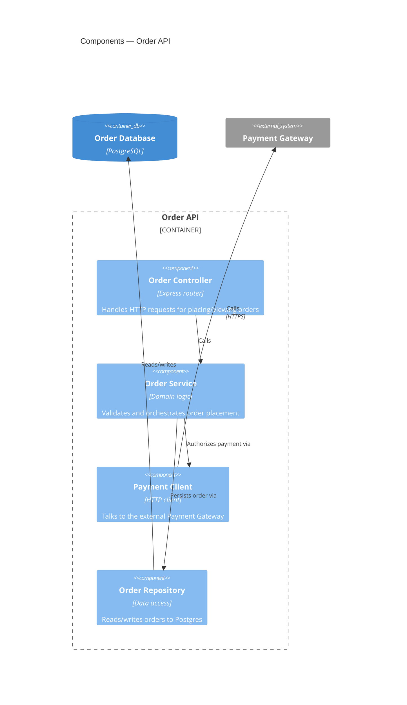

# C4: Component

## Description

The third C4 zoom level: the internal structure of a single container — its major internal building blocks (controllers, services, repositories) and how they collaborate. This is as deep as C4 goes; the model deliberately stops here rather than defining a "Code" level, since class/method-level detail is better shown with UML (and goes stale faster than a hand-maintained diagram can track).

## When to use it

- A single container from the Container diagram is complex enough that "what's inside this box" is a real question — new team members ask it, or the container owns enough responsibility that its internal seams matter.
- You're about to refactor a container's internals and want to agree on the target shape first.
- Don't produce this for every container by default — most containers are simple enough that the Container diagram plus the code itself is sufficient documentation.

## Related levels

- [Container](container.md) — the level above: this container as one box among several, with no internals shown.
- Deeper than this, use UML instead of C4 — [../uml/class.md](../uml/class.md) for the object model, [../uml/sequence.md](../uml/sequence.md) for how components collaborate at runtime.

## Example

