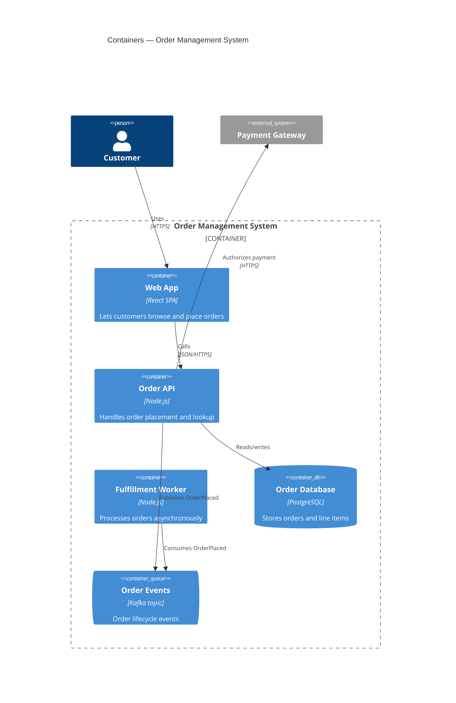

# C4: Container

## Description

The second C4 zoom level: what's inside the system boundary drawn in the Context diagram — the separately deployable/runnable units (services, web apps, databases, message brokers) and how they talk to each other. "Container" means a unit of deployment here, not necessarily a Docker container.

## When to use it

- The system boundary is agreed (Context diagram exists or is obvious) and you need to decide/communicate the high-level runtime shape — this is arc42 §5 (Building Block View) at its top level, and often doubles as §7 (Deployment View) once annotated with where each container runs.
- You're deciding whether something should be its own service or live inside an existing one.
- You need to show technology choices per unit (language, framework, protocol) without drowning in class-level detail.

## Related levels

- [Context](context.md) — the level above: the system as a whole, before it's split into containers.
- [Component](component.md) — the level below: only drill into a specific container's internals when that container is complex enough to need it. Not every container gets a Component diagram.

## Example

