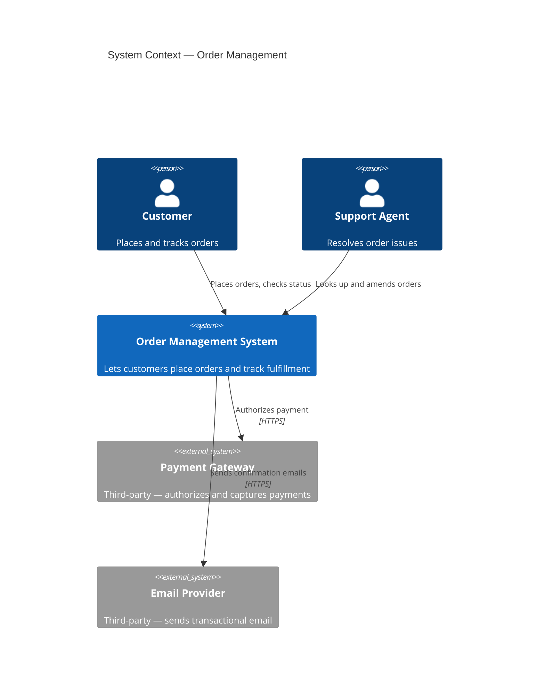

# C4: System Context

## Description

The widest C4 zoom level: the system as a single box, surrounded by the people and other systems it interacts with. No internal structure is shown — the point is to establish the boundary and who/what crosses it, before any internal design decisions are made.

## When to use it

- You're starting a new design and need to agree on scope before discussing structure — this is arc42 §3 (Context and Scope) in diagram form.
- A stakeholder unfamiliar with the internals needs to understand what the system does and who it serves, without being shown implementation.
- You're not sure yet whether something is inside the system or an external dependency — drawing the boundary forces that decision.

## Related levels

- [Container](container.md) — the next zoom level in: once the boundary is agreed, Container shows what's inside it.
- [Component](component.md) — two levels deeper; only reach this after Container, and only for containers complex enough to warrant it.

## Example

