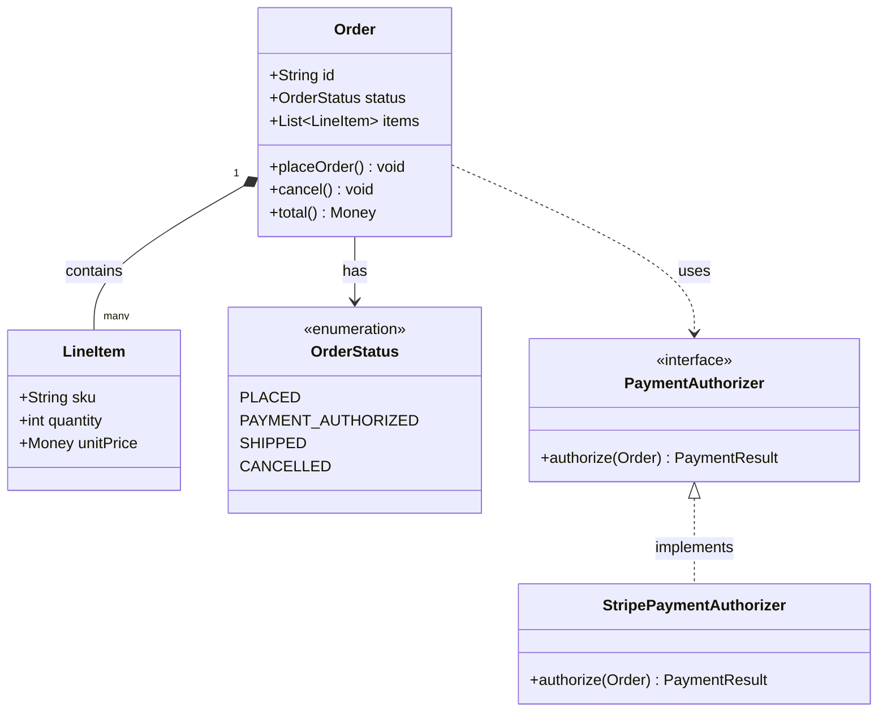

# UML: Class Diagram

## Description

Shows the static object model: classes/types, their attributes and methods, and the relationships between them (association, composition, inheritance, implementation). Where a C4 Component diagram shows boxes-and-arrows at the level of "which parts talk to which," a class diagram shows the actual shape of the data and contracts inside one of those parts.

## When to use it

- A container or component's internal object model has real structure worth agreeing on before writing code — entity relationships, an interface a Strategy/Adapter/Factory pattern hangs off of, an inheritance hierarchy.
- arc42 §5 (Building Block View) needs more precision than a Component diagram gives for one specific container.
- You're documenting an existing system's domain model, not designing a new one — reverse-engineered class diagrams are a good retrofit-documentation artifact.
- Don't reach for this to document every class — only the ones whose relationships aren't obvious from the code itself, or that a new contributor would otherwise have to reconstruct by reading.

## Related diagrams

- [Sequence](sequence.md) — class diagrams show static structure; sequence diagrams show that structure in motion, over time, for one specific scenario.
- [Component](component.md) — one level up: component diagrams show which internal parts exist and their dependencies, without the field/method-level detail a class diagram carries.
- If the object model at hand is a recognizable design pattern (Strategy, Factory, Observer, ...), link to it in the sibling `design-patterns` skill instead of re-deriving the shape here.

## Example

