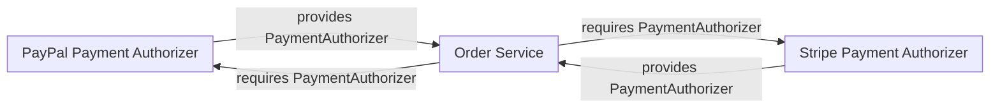

# UML: Component Diagram

## Description

Shows a system's internal components and the interfaces they provide to or require from each other — the classic UML notation uses "lollipop" (provided interface) and "socket" (required interface) symbols to make those contracts explicit. This overlaps heavily with a C4 Component diagram's job; the difference is emphasis: C4 Component emphasizes *what exists and how it's wired*, UML Component emphasizes *the interface contracts between parts*.

**Notation caveat**: Mermaid has no dedicated UML component-diagram syntax (no native lollipop/socket notation). Because this skill standardizes on Mermaid for every other diagram, the default is to **use [../c4/component.md](../c4/component.md)'s `C4Component` notation instead** for internal-structure documentation — it's Mermaid-native and covers the "what exists, how it's wired" job for the vast majority of cases. Reach for true UML component notation (and a renderer that supports it, e.g. PlantUML) only when provided/required interfaces themselves are the point — an interface-heavy boundary (a plugin system, a set of SPI contracts) where "which interface does this satisfy" is the question being answered, not just "which components exist."

## When to use it

- Rare, by design given the notation caveat above — reach for [C4 Component](../c4/component.md) first.
- The system has an explicit plugin/extension-point architecture where documenting *provided vs. required interfaces* is the entire point (e.g. "this component requires a `PaymentAuthorizer`, and three components each provide one").

## Related diagrams

- [C4: Component](../c4/component.md) — the default choice for internal-structure diagrams in this skill; use this UML variant only for the interface-contract case above.
- [Class](class.md) — if the "interface" in question is a single TypeScript/Java `interface` on one class rather than a component-level contract, a class diagram is usually the more precise tool.

## Example

Approximated in Mermaid via a flowchart, since there's no native component/interface notation — labels stand in for lollipop/socket relationships:

For a diagram where the interface notation itself needs to render precisely (true lollipop/socket symbols), use PlantUML's native `component` diagram type instead of forcing Mermaid.
