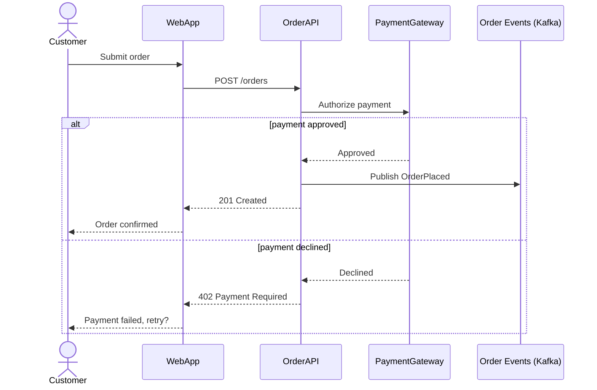

# UML: Sequence Diagram

## Description

Shows how a specific set of participants (people, components, external systems) exchange messages over time for one scenario, in order. Where a Container/Component diagram shows the static wiring, a sequence diagram shows one path through it — which makes it the right tool for arc42 §6 (Runtime View).

## When to use it

- A specific flow is worth walking through explicitly: the critical happy path, a tricky error/retry path, an async handoff between services, a startup or shutdown sequence.
- Multiple components/services participate and the *order* of calls matters (who calls whom, what's synchronous vs. fire-and-forget, where a response is awaited vs. not).
- You're debugging or explaining a bug that only makes sense as a sequence of interactions, not a static structure.
- Don't produce one for every possible flow — pick the handful of scenarios that are actually load-bearing or actually confusing, per arc42 §6's guidance.

## Related diagrams

- [Class](class.md) — sequence diagrams show behavior; class diagrams show the structure that behavior runs on top of. Use both together when a flow's structure isn't already obvious.
- [State Machine](state-machine.md) — a sequence diagram shows one flow end-to-end; a state machine shows every state a single entity can be in and every legal transition between them, across all flows that touch it.

## Example

