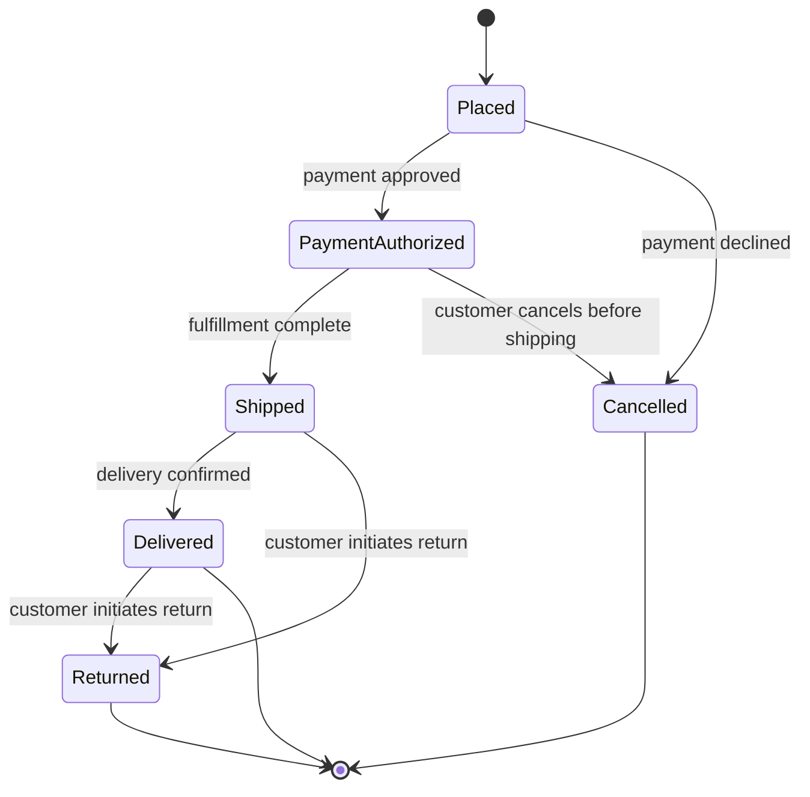

# UML: State Machine Diagram

## Description

Shows every state a single entity can be in, and every legal transition between them, independent of any one flow through the system. Named `state-machine.md` rather than `state.md` to avoid confusion with the `design-patterns` skill's State *pattern* — this is a documentation diagram, not the OOP pattern (though a State-pattern implementation is often exactly what a state machine diagram is documenting).

## When to use it

- An entity's behavior genuinely depends on which state it's in, and the legal transitions aren't obvious from reading the code (an order lifecycle, an approval workflow, a connection's lifecycle).
- You're specifying arc42 §8 (Crosscutting Concepts) for a stateful concern that spans multiple components — the state machine is the concern, not any one component's implementation of it.
- You need to answer "can this entity go from state X to state Y directly, or must it pass through Z" — a question sequence diagrams can't answer, since each one only shows a single path.
- Skip this for entities with only two states or where every state can reach every other state — the diagram adds nothing a sentence wouldn't.

## Related diagrams

- [Sequence](sequence.md) — a sequence diagram shows one path through a system for one scenario; a state machine shows the complete space of legal states and transitions for one entity, across every scenario.
- If the entity's state-dependent behavior is implemented via the GoF State pattern, link to it in the sibling `design-patterns` skill — the diagram documents the *shape*, the pattern page documents the *implementation technique*.

## Example

